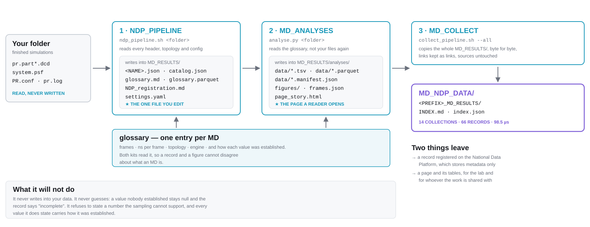

## How to read this guide

This guide is for everyone in a research group: undergraduates, graduate students, postdocs and PIs.

- **New to MD data or to the command line?** Read sections 1–4 in order, and the boxes marked
  **New to this?**
- **Just want the commands?** Go straight to section 4, *Quick start*.
- **Want Claude to do it for you?** Section 3 shows how. Claude follows the runbook
  `RUNBOOK.md`, which sits beside this file.
- Boxes marked **For experts** point to extra options you can safely skip.

Everything is in the archive you unzipped (called `$K` below):

```
MD_NDP_PIPELINE/
  NDP_instructions.md / .pdf   <- this guide (for people)
  RUNBOOK.md                   <- the runbook (for Claude, or for copy-pasting commands)
  lab.yaml                     <- your lab's settings: fill it in once, before the first run
  README.md                    <- installation and configuration
  NDP_PIPELINE/  MD_ANALYSES/  MD_COLLECT/  MDDB_PIPELINE/   <- the tools
  examples/                    <- two finished, published outputs (section 7)
```

---

## 1. The one-minute picture

You finished a molecular dynamics (MD) simulation. On disk it is hundreds of gigabytes of files
with names like `pr.part07.dcd`. Nobody but you can tell what it is. The pipeline turns that
folder into two things:

1. **A record**: a small JSON file that says what the simulation is (system, length, force field,
   who ran it). The lab registers it on the **National Data Platform (NDP)** and lists it on the lab
   website.
2. **A page**: analyses (RMSD, RMSF, contacts, binding energy, water…) drawn as figures you can
   click, in a web page you can share.

It does this **without moving, renaming or changing any of your files.**



It runs in four steps, each done by one tool ("kit"):

| Step | Kit | Question it answers | You run |
|---|---|---|---|
| 1. Describe | `NDP_PIPELINE` | *What is this data?* | one command |
| 2. Curate | you, in `settings.yaml` | *What only I know* | a text editor |
| 3. Analyse | `MD_ANALYSES` | *What does it show?* | one or two commands |
| 4. Share and register | `MD_COLLECT` + the NDP website | *Where can others find it?* | one command, then a web form |

> **New to this? A few words you will meet**
>
> - **Trajectory**: the file(s) with the atom positions over time (`.dcd`, `.xtc`). Big.
> - **Topology**: the file that says which atom is which (`.psf`).
> - **Replica**: the same system simulated again from a different start. Replicas are grouped into one record.
> - **Production phase**: the part of the simulation you analyse. It comes after minimisation, heating and
>   equilibration. Only production is published.
> - **Glossary**: a table the pipeline builds with one row per MD: frames, time per frame, topology.
>   Every other step reads it, so the numbers always agree.
> - **Record**: the JSON file describing one simulated system on NDP.
> - **NDP**: the National Data Platform, a national catalogue of research data. It stores
>   *descriptions* of data, never the trajectories themselves.
> - **Embargo / private**: unpublished work is registered as *private* until the paper is out.

---

## 2. Before you start

You need:

1. **The tools installed once.** Unzip the archive, then follow *Quick start* in `README.md`.
   You need a Python with `pandas`, `pyarrow` and `pyyaml` (`requirements-ndp.txt`) and the
   `mdviz` conda environment (`MD_ANALYSES/env/environment.yml`). For some analyses you also need
   `cpptraj` from AmberTools.
2. **Finished simulations.** The pipeline is for runs that have stopped. If a job is still writing,
   wait for it to finish; otherwise you get a half-finished snapshot.
3. **One project folder** that holds one set of related simulations, e.g.
   `/data/<you>/MY_PROTEIN/MDs`. It must be **one project**, not the folder above several
   projects (see section 9).
4. A few minutes for Step 1. The analyses can take hours for large systems.

> **New to this? Opening a terminal**
>
> Open a terminal on the machine that holds your data (e.g. `ssh <you>@<machine>`). Every command below is typed into that
> terminal. Lines that start with `#` are comments and do nothing. Copy a whole block, paste it,
> press Enter.

---

## 3. The easy way: let Claude run it

If you use Claude Code, start it and give it the runbook:

```bash
claude --add-dir /path/to/MD_NDP_PIPELINE
```

Then type:

```
Read /path/to/MD_NDP_PIPELINE/RUNBOOK.md and run it on /path/to/<project-folder>
```

Claude will check your folder, run each step in the right order with the right Python, and
**stop to ask you** whenever it needs something only you know, such as the title, the identifier
or the paper. It never deletes anything and never publishes anything; registering on NDP stays your
decision. Section 5 is still worth reading: the answers Claude asks for are
the same ones you would type yourself.

---

## 4. Quick start: the commands

Replace the two paths with your own, then paste block by block.

**Setup (once each time you open a terminal):**

```bash
export K=/path/to/MD_NDP_PIPELINE                   # where you unzipped the archive
export F=/path/to/<project-folder>                  # ONE project of finished MDs
export SUBSTRATE_PYTHON=$(which python3)            # the Python with pandas, pyarrow, pyyaml
export P=$(conda run -n mdviz which python)         # the analysis environment
```

**Step 1: describe the data** (reads every trajectory header once; minutes for most folders):

```bash
$K/NDP_PIPELINE/ndp_pipeline.sh "$F" --yes
```

It ends by telling you what it could not work out. That is normal and expected.
If your folder was already built, running this again is safe: your edits in `settings.yaml` are kept.
Now look inside your folder: a new `MD_RESULTS/` folder has appeared.

**Step 2: fill in what only you know.** Open `$F/MD_RESULTS/settings.yaml` in any editor
(`nano`, `vim`, VS Code) and follow section 5. Then rebuild and check.

If you changed `stages:`, `replicas:`, `production_lengths_ns:` or `frame_interval_ps`, rerun the
**Step 1 command** instead: those settings only take effect through a full run. (If you forget,
`ndp_build.py` prints a NOTE saying so.) For everything else:

```bash
$SUBSTRATE_PYTHON $K/NDP_PIPELINE/ndp_build.py "$F"
$SUBSTRATE_PYTHON $K/NDP_PIPELINE/ndp_build.py "$F" --check
```

`--check` changes nothing. It prints a line such as `3/4 record(s) ready`. It exits with an error code while
any record is incomplete; that only means "not ready yet". To see **what is missing**, open
`$F/MD_RESULTS/NDP_registration.md`.

**Step 3: analyse:**

```bash
$P $K/MD_ANALYSES/analyse.py "$F" --detect-only                 # what is in each system? writes nothing
$P $K/MD_ANALYSES/analyse.py "$F" --only composition,structure   # RMSD, RMSF, Rg, composition
```

Then open `$F/MD_RESULTS/analyses/<record>/page_story.html` in a web browser.

**Step 4: share and register:** see section 8.

> **For experts: more analyses and options**
>
> - **Stages** for `--only` (comma-separated): `interface_contacts`, `binding_energy`, `ions`, `water_shell`,
>   `water_bridges`, `water_residence`, `density_grids`, `rdf`.
> - **Other options:**
>   - `--system <record>` analyses one system only
>   - `--stride N` uses every Nth frame
>   - `--pages-only --page story|plotly|paper|both` redraws pages without recomputing
> - **Long jobs:** run inside `tmux` or `screen`.
> - **Pipeline flags:**
>   - `--production-view` links the production files into `MD_RESULTS/production_files/`
>   - `--pdb-offline` uses no internet
>   - `--deep` counts frames in `.xtc` files
>   - `--rebase-root` for a folder that was moved
> - **cpptraj elsewhere:** `export CPPTRAJ=/path/to/cpptraj` if it is not on your PATH.
> - **Your lab, once:** everything lab-specific (lab name, identifier prefix, topics, people, data
>   owner, storage) is in `$K/lab.yaml`. Fill it in before the first run; it is the only file a lab
>   edits. `examples/lab.yaml` shows a filled-in one. Check it with
>   `python3 $K/NDP_PIPELINE/core/lab.py`.

---

## 5. Filling in `settings.yaml` (the only file you ever edit)

The pipeline fills in everything it can **measure**. What is left is what only **you know**.
Your text is never overwritten, and every change is backed up automatically.

The file has five parts:

```yaml
collection_prefix: SARS-CoV-2-Spike   # 1. the project's name in the shared collection. KEEP AT THE TOP.

folder:                           # 2. which subfolders to read, and what the files really are
  corpora: [...]                  #    subfolders that ARE simulations
  prune: [...]                    #    subfolders to ignore
  stages:                         #    only if a file name does not say what it is (see below)
    production: 'OPEN/.*_run_[0-9]+\.dcd$'

production_lengths_ns: [1000, 400]  # 3. how long a full production run is in this project

datasets:                         # 4. the science: authors, contact, licence, paper, PDB entries
  ...

ndp:                              # 5. one block per simulated system: the catalogue record
  systems:
  - id: OPEN/e0812b9a             #    (written by the tool; do not change)
    identifier: SMITHLAB-SARSCOV2-SPIKE-OPEN   # from your catalogue: <PREFIX>-<TOPIC>-<DESCRIPTOR>
    topic: covid-19               #    hiv, influenza, covid-19, ebola, ... (`topics:` in lab.yaml)
    title: SARS-CoV-2 full-length spike glycoprotein, open state: all-atom MD
    nominal_lengths_ns: [1000, 400]   # optional: 3 x 1 us conventional + 3 x 400 ns adaptive
    construct:                    #    what was built
    starting_structure:           #    which PDB / model
    glycan_profile:
```

**What you must fill in** before a record counts as *ready*:

- `identifier` and `topic`. Use the next free identifier in your lab's catalogue. If you leave them empty, the
  pipeline **guesses** them from folder names. The record still says *ready*, but
  `NDP_registration.md` lists every guess under *"Suggested by the pipeline: confirm before
  registering"*. Never register a guess you haven't checked.
- `title`, `construct`, `starting_structure`, `glycan_profile`
- authors, contact and citation under `datasets:`
- `access_level` (`public` | `private` | `licensable`: who may get the raw files) and
  `ai_training` (`allowed` | `prohibited` | `by-agreement`: whether the data may train AI/ML
  models, a question the citation licence does not answer). **Ask the data owner.** Nothing
  guesses these. Write them once in `lab.yaml` if one policy holds for the whole lab, or under
  `ndp: defaults:` for the whole folder, in a dataset's block, or in one system.

**Where to type each answer.** Every field a record is still missing has an empty line in that
system's own block under `ndp: systems:`. If a field goes missing later, the next build adds the
line for you, marked `# missing: fill in for this system`. Construct, structure, glycans, ions and
water usually differ between systems, so answer them in each system's block.

The data owner (the PI) and the storage the raw files live on come from `lab.yaml`; the path to
the raw files is measured. Change any of them under `ndp: defaults:` if this folder differs.

> **The silent trap**
>
> Each system block already ends with empty keys (`slug:`, `title:`…). If you add your own `slug:`
> near the top, the empty one further down **wins without any warning**. Always type your value
> **on the key that is already there**.

> **For experts: what a trajectory really is**
>
> A `.dcd` whose name says nothing is treated as **production** until you say otherwise. A
> `stages:` rule (a regular expression on the path inside your folder) overrides everything.
>
> - **Stage names:** `production`, `equilibration`, `heating`, `minimisation`, `merged`, `stripped`,
>   `superseded`, `derived`. A typo stops the build rather than guessing.
> - **Phases in the record:** only the production phase goes into the NDP record. `ndp: defaults:
>   protocol: all` puts the other phases back.
> - **Missing frame spacing:** if the pipeline says a replica has no frame spacing, add
>   `frame_interval_ps: <number>` to that system.
> - **Replicas in one directory:** files named `R1`/`1R`/`rep1`, or ending in a bare `_1 … _6`,
>   are recognised as replicas. A bare number counts only if every file starts at the same step.
>   For other names, add under `folder:`: `replicas: ['_run_(\d+)\.dcd$']`. The part in
>   brackets is the replica number.
> - **Replicas run to two lengths on purpose** (e.g. 3 × 1 µs + 3 × 400 ns adaptive): add
>   `nominal_lengths_ns: [1000, 400]` to that system. The two length warnings then become a note.
> - **Stable file names:** once a record has a file name, a change in replica count does not
>   rename it (so hosted links keep working). Add `rename: true` to that system to allow it.
> - **Comments:** leave a space before `#` after a value, or YAML reads the comment as part of it.

---

## 6. What you get

Open `examples/` in the archive to see real output before you run anything (section 7).

```
<your folder>/
  MD_RESULTS/                 <- everything you read and share
    README.md                 a summary written about YOUR data
    settings.yaml             the one file you edit
    glossary.md               one line per MD: frames, length, topology
    <system>.json             the NDP record(s)
    NDP_registration.md       what to paste into the NDP form, and what is missing
    standard_formats/         the same records as schema.org/DCAT and RO-Crate, for any
                              catalogue (NDP's CKAN, Google Dataset Search, RO-Crate tools)
    analyses/<record>/
      page_story.html         the page to share: open it in a browser
      page_plotly.html        the working page, everything at once
      data/                   every number, as tables
      figures_user/           put your own VMD pictures here; they appear on the page
  .md_pipeline/               machinery; safe to ignore (and to delete; it is rebuilt)
```

On the analysis page, **click any point on a curve** and it tells you the exact frame, the file it
lives in, and a VMD command that opens that frame.

---

## 7. Two worked examples (both published)

`examples/` holds the finished `MD_RESULTS/` folders of two published projects. They contain
metadata and analyses only; the trajectories are not included.

**SARS-CoV-2 spike** (`examples/SARS-CoV-2-Spike_Casalino2020_MD_RESULTS/`). Casalino et al.,
*Beyond Shielding: The Roles of Glycans in the SARS-CoV-2 Spike Protein*, ACS Cent. Sci. 2020.

- **The system:** three systems (open, closed, N165A/N234A mutant), 15 replicas, 10.2 µs in
  total, protein and glycans only (72,759 atoms), one frame every 100 ps.
- **Replicas in one directory:** the trajectories are named `…_1.dcd … _6.dcd` in one directory. The
  pipeline recognises them as six replicas because every file starts at step 0.
- **Mixed lengths on purpose:** replicas 1–3 run about 1 µs, replicas 4–6 about 400 ns (adaptive
  sampling). This is why `nominal_lengths_ns: [1000, 400]` exists.
- **No NAMD configs were archived,** so ensemble, temperature and timestep are typed in
  `settings.yaml`. The record carries a `config_declared` note to say so.
- **What to open:** `settings.yaml` (a fully curated example), the three record JSONs,
  `NDP_registration.md` and `analyses/*/page_story.html`.

**HIV-1 Env, closed, full length** (`examples/HIV-Env-Closed-FullLength_2026_MD_RESULTS/`).
*N-Glycans modulate tilting of HIV-1 envelope glycoprotein*, Nat. Commun. 2026.

- **The system:** one membrane-embedded system (256,522 atoms), 5 × 1050 ns.
- **A record written in full:** the JSON shows what a complete description looks like.
- **A third page, `page_paper_story.html`:** made with `import_paper.py`, it places the article's
  own figures (CC-BY-4.0) beside the measurements.
- **A guessed identifier:** this record's identifier (`…-HIV-MDS-001`) was suggested from the folder name
  `MDs` and never confirmed. It is exactly what the *"Suggested by the pipeline: confirm before
  registering"* list in `NDP_registration.md` is there to catch.

---

## 8. Sharing and registering on NDP

### Sharing with your group

MD_COLLECT copies each finished `MD_RESULTS/` into one shared collection, so a group can browse
every project in one place. Its `INDEX.md` lists them.

1. Set `collection_prefix:` at the top of your `settings.yaml`, for example `SARS-CoV-2-Spike`.
2. Preview, then copy (by whoever owns the collection):
   `$K/MD_COLLECT/collect_pipeline.sh "$F/MD_RESULTS" --dry-run`, then the same without `--dry-run`.
   The collection goes to `$MD_COLLECT_DEST` (default `~/MD_NDP_DATA`).

> **Important:** `MD_RESULTS/production_files/` contains *shortcuts* (symlinks) to your trajectories.
> Never copy it with `rsync -L`, `cp -L` or `tar -h`, or you will copy terabytes. Use `rsync -a` or `cp -a`.

### Registering on the NDP

This is done **by a person, in a web browser.** Nothing registers automatically.

1. Open `MD_RESULTS/NDP_registration.md`. For each record it gives the text for each field of the NDP
   form, in order, and lists anything still missing.
2. On nationaldataplatform.org:
   - **Prepare**: host each record's JSON at a web address (GitHub, Zenodo, your lab site) and set
     `base_url` under `ndp: defaults:`. Host `standard_formats/` with it: `catalog.dcat.jsonld`
     lists every record in the DCAT format that NDP's catalogue software (CKAN) reads.
   - **Register**: in the NDP Catalog, choose *Add to Catalog*.
   - **Approval**
   - **Attach**: to your group's workspace, if it has one.
   - **Publish**
3. **Register as private** while the paper is not yet published, and confirm with the PI before
   anything goes public.

### Optional: MDDB deposition

For depositing trajectories to the MDDB database, there is a separate kit. It reads the same glossary:

```bash
$SUBSTRATE_PYTHON $K/MDDB_PIPELINE/mddb_build.py "$F"
cd "$F/.md_pipeline/mddb/work/<dataset>" && conda activate mwf_env && mwf run -dir . -inp inputs.yaml
```

Note: `mwf_env` is a ~10 GB conda install (`$K/MDDB_PIPELINE/install_mwf.sh`).

---

## 9. If something goes wrong

Read the last lines the command printed, find them below, fix, and simply **run the same command
again**. Re-running is always safe.

| The message says… | What it means, and what to do |
|---|---|
| `Refused: this folder contains N folder(s) that have already been built` | You pointed one folder too high. Use one of the folders it lists. |
| `Refused: folder: root: says ...` | The folder was moved or renamed. Add `--rebase-root`. |
| `cannot run this. Name one that can: export SUBSTRATE_PYTHON=...` | You skipped the setup block, or that Python lacks pandas/pyarrow/pyyaml. See section 4. |
| `no cpptraj found` | Install AmberTools, or `export CPPTRAJ=/path/to/cpptraj`. |
| lines about permissions, then it stops | The tools' safety check found files others can change. Run `chmod -R go-w $K` and try again. |
| `N top-level directories are neither indexed nor pruned` | Add each to `corpora:` (read it) or `prune:` (ignore it). |
| a record appeared for something that is not a simulation | Delete that entry from `corpora:`. Adding it to `prune:` is not enough. |
| `N MD(s) flagged short_of_nominal` | Set `production_lengths_ns:` to how long a full run is in your project. |
| `N MD(s) flagged stage_assumed` | Add a `stages:` rule saying what those files are. |
| `SKIPPED: n replica(s) have no frame spacing` | Add `frame_interval_ps:` for that system. |
| `N MD(s) flagged no_topology` | A trajectory matches no `.psf` beside it. A file there probably belongs to another run. |
| record is `incomplete` | A field only you can fill is still empty in `settings.yaml`. |
| `... changed in settings.yaml since the glossary was built` | Rerun the Step 1 command. |
| `N record(s) carry a SUGGESTED identifier/topic/tags` | Check the guesses listed in `NDP_registration.md`; type the right values in `settings.yaml`. |
| `the MDs disagree (1000, 400)` and `replica lengths are very uneven` | If the lengths differ on purpose, add `nominal_lengths_ns: [1000, 400]` to that system. |
| six files `name_1 … name_6` became one long MD | Add a `replicas:` rule under `folder:` (section 5, *For experts*). |
| you edited `settings.yaml` and nothing changed | See *The silent trap* in section 5. |
| `nothing to rebuild from: run the stages first` | Run an analysis before `--pages-only`. |

Still stuck? Email the authors (**maalbani@ucsd.edu**) with the last 20 lines of output.

---

## 10. The rules in one place

1. **One project folder per run**, never the folder above several projects.
2. **Only finished simulations.**
3. **Your data is never written to.** Everything new is in `MD_RESULTS/` and `.md_pipeline/`.
4. **`settings.yaml` is the only file you edit** for a project, and your text is never
   overwritten. What belongs to the whole lab (name, prefix, topics, data owner) is in `lab.yaml`.
5. **Only the production phase is published.**
6. **Never invent metadata.** If you do not know a field, leave it empty and ask.
7. **Keep unpublished work private** on NDP.
8. **Never copy `production_files/` with `-L`.**

## 11. Where to read more

- `RUNBOOK.md`: the step-by-step runbook
- `README.md`: installation, configuration and tests
- `lab.yaml`: everything that belongs to one lab (`examples/lab.yaml`: a filled-in one); `CHANGELOG.md`: what changed in each version
- `examples/README.md`: what each file of the two examples is
- `docs/COMPARISON.md`: how this compares with other MD metadata tools
- The README of each kit: `NDP_PIPELINE/`, `MD_ANALYSES/`, `MD_COLLECT/`, `MDDB_PIPELINE/`
- `MD_RESULTS/README.md` in your own folder, written about your data
